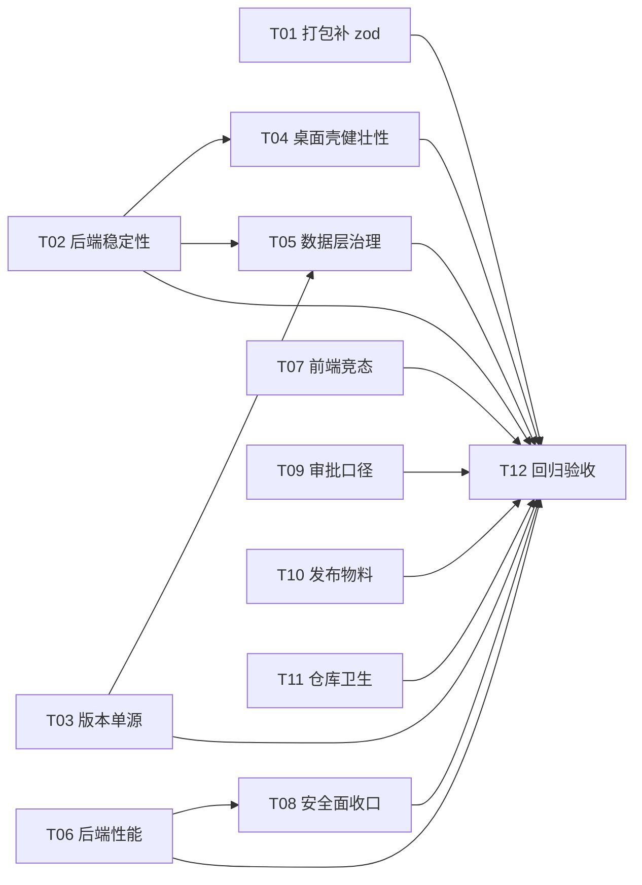
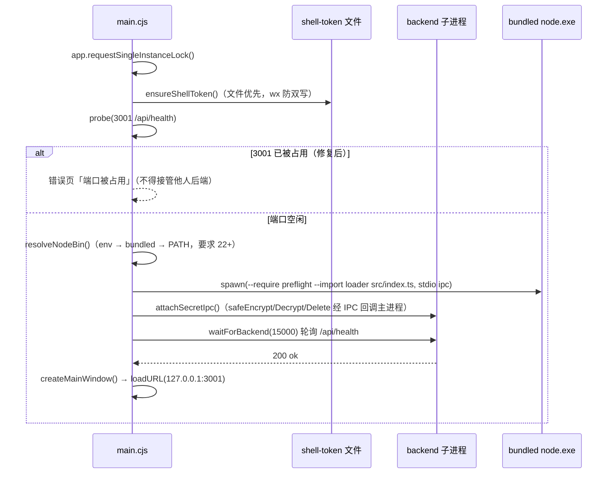
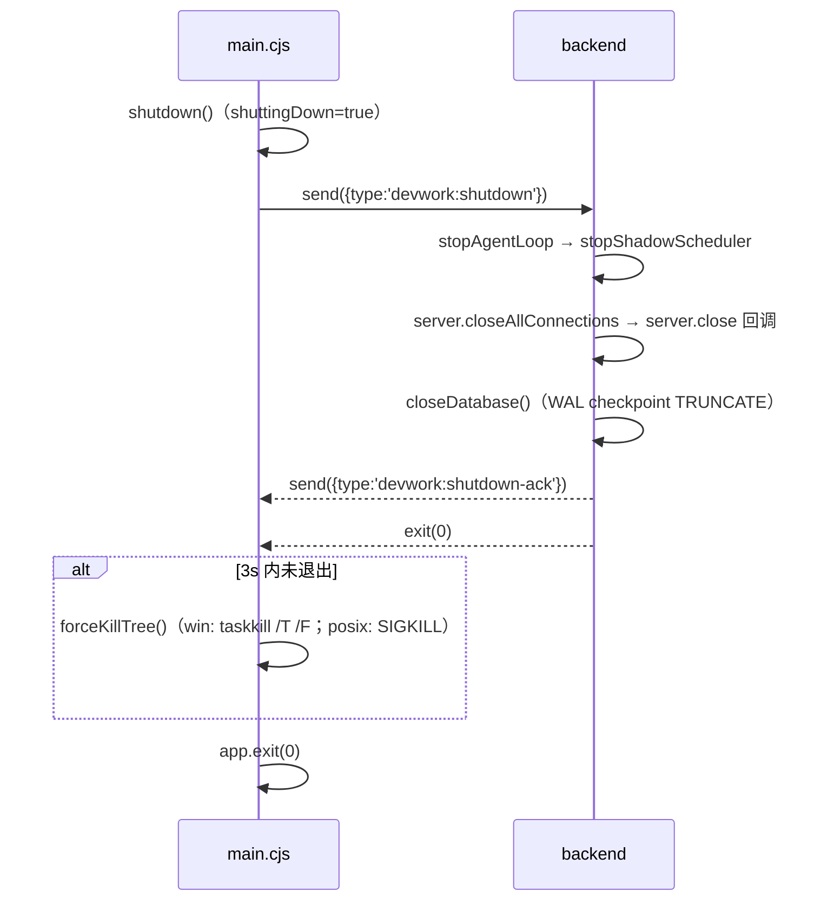

# DevWork v1.0.0 全量代码审查 · 发布就绪差距分析 · 修复任务清单

> 审查人：高见远（架构师）· 日期：2026-11-14
> 对象：`D:\code\DevWork\devwork-app`（v0.4.2，215 个受跟踪文件，HEAD 工作区干净）
> 基准：`docs/devwork-architecture.md`（五条硬约定 + 13 条陷阱）、`docs/devwork-alignment-audit.md` §10（已修过的不重复报）、`docs/devwork-v1.0-release-prd.md`
> 范围：**只审代码事实**（缺陷 / 风险 / 发布链路），不评判产品功能取舍

## 0. 审查方法与边界（先说清楚结论的分量）

| 做了什么 | 说明 |
|---|---|
| 全量静态阅读 | `desktop/*.cjs`(1243 行) · `backend/src`(全部 66 文件) · `frontend/src`(关键 20 文件) · `scripts/*`(全部) · `shared/contracts` · 构建/打包配置 |
| 只读命令 | `npm run typecheck`（实测 0 error）· `git ls-files` · `tsc --noUnusedLocals` · `require.resolve` 解析验证 · `ls release/build/win-unpacked` |
| 受控实验（2 个，内存内，不写业务数据） | ① Express 4 async handler 抛错 → 请求挂起 + `unhandledRejection`（实证）② Node 22 未处理拒绝 → 进程退出（实证） |
| **未做** | 未运行 `test:smoke` / `test:shadow` / `test:agent-tools` 等会写库或起进程的测试；未运行 `npm run dist`；未改动任何业务代码、`backend/.runtime`、`node_modules`、`dist`、`release`、`build` |

> **结论边界**：本报告的每条缺陷都有 `文件:行`，均可被第二人独立复核。运行期行为类问题（Mock 网关语义、工单状态机推进、视觉回归）不在本轮结论范围内 —— 这需要跑测试，属 T12 的执行内容。

---

## 1. 结论表

| 维度 | 判定 | 一句话依据 |
|---|---|---|
| 进程与生命周期（Electron + 子进程） | **有风险** | 优雅关停链路（IPC ack → WAL checkpoint → `taskkill /T`）设计完整且正确；但**后端崩溃后无人管**（`main.cjs:453` 只打印日志），且打包态可能静默挂到别人的 3001（`main.cjs:920`） |
| 后端安全面（路径 / shell / SQL / 凭据） | **有风险** | 路径越界三道校验（`file-service.resolve`、`assertInside`、敏感规则）质量高；**两处漏点**：`safeJoin` 前缀判定缺分隔符（`command-executor.ts:199`）、克隆凭据被写进 `.git/config`（`workspace-repos.ts:274`） |
| 数据层（schema / WAL / 迁移） | **有风险** | schema 幂等、`ensureColumn` 补列、WAL + `busy_timeout` 正确；**启动期全表扫描**（`normalizeAuditActors` / `migrateCitations`）随库增长线性拖慢首启；删会话留孤儿行 |
| 并发与状态机（agent-loop / shadow / tickets） | **通过（有保留）** | 状态全在表里 + `recoverShadowState()` 抹锁 + `busy` 互斥 + `tx()` 条件插入，设计正确；保留项：`stopAgentLoop()` 不停在跑的 `runAssignment`，关停窗口内仍会写库 |
| 契约一致性（42 写端点 / zod 边界） | **通过** | 70 条写路由，**50 处 `parseBody`，零处裸读 `req.body`**（`helpers.body()` 已无人调用）；`audit/export` 走 query+body 合并但全程参数化查询 |
| 前端健壮性（竞态 / 超时 / 泄漏） | **有风险** | 定时器与监听均有 cleanup；**切工作区不重拉快照**（`live.tsx:442` 依赖只有 `tick`）、**切会话右栏切片不重置**（`live.tsx:114`）、`getFileOutline` 用默认 2.5s 超时打同步读整仓 |
| **发布链路（打包 → 安装 → 首启）** | **阻断** | **打包产物缺 `zod`**：`stage-runtime.mjs:84` 只暂存 express/cors/tsx，而后端经 `shared/contracts` 运行时依赖 zod。开发机因「产物在仓库内 → 向上解析到 `devwork-app/node_modules/zod`」而假通过，装到仓库外必崩 |
| 后端可用性（异常兜底） | **阻断** | `/stream` 是全仓唯一未包 `wrap()` 的 async 路由（`conversations.ts:172`），后端无 `unhandledRejection` 兜底 → 粘贴 >20 万字符消息即**后端进程退出**，打包态不自动重启 → 窗口变空壳 |
| 仓库卫生 / 发布物料 | **有风险** | 2 个 `vite.config.ts.timestamp-*.mjs` 被跟踪；根目录**无 README / CHANGELOG / LICENSE**（PRD P0-6 已列）；`electron-builder.yml:3` copyright 仍是 "DevWork local demo" |

**计**：P0 阻断 **4** 条 · P1 严重 **11** 条 · P2 一般 **16** 条 · 待验证 2 条。

> 上行为**首次审查时**的计数。§8 附录追加实施期新发现后，全文合计为 **P0 4 / P1 13 / P2 18**：
> 新增 A-P1-12（端口同源 + 子进程 env 透传，PRD 定档 P1-9）、A-P1-13（`tests/db-integrity.mjs` 陈旧断言）、
> A-P2-17（`desktop-ipc` 不可无人值守）、A-P2-18（契约注释仍宣称 `scope:session` 可用）。

---

## 2. 缺陷清单

### 2.1 P0 · 发布阻断（4 条）

| ID | 严重级 | 模块 | 文件:行 | 现象 | 根因 | 修复建议 | 验收方式 |
|---|---|---|---|---|---|---|---|
| **A-P0-01** | P0 | 发布链路 | `scripts/lib/stage-runtime.mjs:84`、`shared/contracts/asset.ts:9` 等 7 处 `import { z } from 'zod'` | 安装到仓库外的机器上，后端启动即 `ERR_MODULE_NOT_FOUND: Cannot find package 'zod'`。窗口只显示「后端服务未就绪」错误页 | `copyDependencyClosure(['express','cors','tsx'])` 漏了 **zod**。zod 是 `dependencies` 里的运行期依赖（`backend/src/routes/*.ts` → `shared/contracts` → zod），但它不在 express/cors/tsx 的依赖闭包里 | ① `stage-runtime.mjs` 依赖列表加 `'zod'`；② `package.mjs:150-157` 的产物自检增加 `server/node_modules/zod` 存在性断言；③ `smoke-package.mjs` 增加「从仓库外临时目录启动」的断言（当前在 `build/pkg` 内启动，会被上层 `devwork-app/node_modules` 救活） | `node scripts/package.mjs --dir` 后 `release/build/win-unpacked/resources/server/node_modules/zod/package.json` 存在；把 `win-unpacked` 整体拷到 `C:\tmp\dw\` 双击 → 三栏首屏；`node scripts/preflight-release.mjs` 在缺 zod 时红 |
| **A-P0-02** | P0 | 后端可用性 | `backend/src/routes/conversations.ts:172-173`、`shared/contracts/conversation.ts:10`、`backend/src/index.ts`（无 `unhandledRejection`/`uncaughtException`） | 在聊天框粘贴 **>200,000 字符**后发送 → 后端进程退出，界面变空壳且无任何提示；每次复现 | ① `content` 契约上限 200,000（`conversation.ts:10`）；② `/stream` 是**全仓唯一**未包 `wrap()` 的 async 路由，`parseBody` 抛 `ApiFailure` 后 Express 4 **不转发给错误中间件**（已实证：请求挂起 + `unhandledRejection` fired）；③ 后端无 `process.on('unhandledRejection')`；Node 22 默认将未处理拒绝升为未捕获异常并退出（已实证 exit code=1） | ① `/stream` 前置段 `try { … } catch (e) { fail(res, …); return; }`（或整段包进 `wrap`，注意 `writeHead` 之前不得抛）；② `index.ts` 启动最前面加 `process.on('unhandledRejection')` + `process.on('uncaughtException')`：`appendLog('ERROR', …)` 后**不退出**；③ `main.cjs` 后端异常退出时给出可见提示（见 A-P1-02） | `curl -X POST /api/conversations/<id>/stream -H 'Content-Type: application/json' -d '{"content":"<200001 个字符>"}'` → **400 `E_VALIDATION`**；随后 `curl /api/health` 仍 200；后端 PID 未变 |
| **A-P0-03** | P0 | 版本单源 | `backend/src/routes/system.ts:97`（`version: '0.4.2'`）、`backend/src/db/seed.ts:198`、`frontend/src/api/mock.ts:537` | 发 1.0.0 后 `/api/health` 仍返回 `version: 0.4.2`；老库升级后「关于 / 检查更新」永远显示 0.4.2 | `check-version.mjs` 只校验 `package.json ↔ builder.yml ↔ release feed`，**不覆盖这三处字面量**；`setting.about` 只在首启 seed 时写入，`seedIfEmpty` 对已有库不重写 | ① 三处改为从单一来源派生（后端 `import pkg from '../../package.json'` 或 `process.env.npm_package_version` 兜底常量文件；前端改用已有的 `__APP_VERSION__`）；② `db/migrate.ts` 新增 `migrateAboutVersion()`，启动时把 `setting.about.version` 覆盖为当前版本（幂等）；③ `check-version.mjs` 增加对这三处的 grep 断言 | `npm run check:version` 通过且能拦住回退；`curl /api/health` → `version=1.0.0`；拿 0.4.2 的 `devwork.sqlite` 启动后「关于」显示 1.0.0（PRD A7/A11） |
| **A-P0-04** | P0 | 仓库卫生 / 发布物料 | 仓库根：无 `README.md` / `CHANGELOG.md` / `LICENSE`；`electron-builder.yml:3` `copyright: DevWork local demo`；`devwork-app/package.json:1-6` 缺 `description`/`author`/`license` | 1.0.0 交付物无安装说明、无变更记录、无许可声明；产物属性里 copyright 写着 "local demo" | 从未创建过这三件物料（`git ls-files` 已确认） | 按 PRD §8 裁决补：`README.md`（安装/启动/环境要求/**已知限制 4 条**/受控写标注「实验性」/更新能力标注「预留」）· `CHANGELOG.md`（1.0.0 条目）· `LICENSE`（**Proprietary**，禁再分发与反编译、无担保，不加开源徽章）；`package.json` 补 `description`/`author`/`license: "UNLICENSED"`；`electron-builder.yml` copyright 改正式文案 | `ls README.md CHANGELOG.md LICENSE` 三件齐；`npm run dist` 后 exe 属性 copyright 非 "local demo"（PRD A8） |

### 2.2 P1 · 严重（11 条）

| ID | 严重级 | 模块 | 文件:行 | 现象 | 根因 | 修复建议 | 验收方式 |
|---|---|---|---|---|---|---|---|
| **A-P1-01** | P1 | 进程 / 数据隔离 | `desktop/main.cjs:898-931` | 打包态下若 3001 已被**别的后端**（如上一次崩溃残留、或正在跑的 `npm run dev`）占用：本实例 spawn 的后端 EADDRINUSE 立刻退出，但 `waitForBackend()` 探到**别人的** `/api/health` 返回 200 → `healthy=true` → 窗口正常打开，**读的是别人的数据目录**（可能是 `backend/.runtime` 的开发库） | 打包态故意不先探活（`:894-906`，为避免加载开发页面），但 `spawnBackend()` 失败后没有区分「自己的后端起来了」与「端口上本来就有人」 | ① spawn 前先 `probe(API_PORT,'/api/health')`，若已通则**不 spawn**，直接出错误页并提示「3001 被占用，请先关闭残留进程」；② 或让 `/api/health` 返回 `instanceId`（进程启动时随机生成 + 写进 token 文件旁），壳只认自己的 | 先 `npm run dev:server`（端口 3001）→ 启动打包版 exe → 出现明确错误页，**不得**展示开发库里的工作区/会话 |
| **A-P1-02** | P1 | 进程生命周期 | `desktop/main.cjs:453-456` | 后端运行中崩溃（含 A-P0-02 触发的退出）后，主进程只打一行日志，窗口继续显示，用户看到的是「界面在、数据全空、点哪都超时」 | `backendChild.on('exit')` 无任何恢复动作；无重启、无错误页、无托盘提示 | ① 非 `shuttingDown` 状态下的异常退出 → 自动重启一次（带退避），再失败则把窗口切到错误页并给「重试」按钮；② 托盘 tooltip / 窗口标题加「后端已断开」 | 打包态手工 `taskkill` 后端进程 → 5 秒内界面出现明确提示（或自动恢复），不再静默 |
| **A-P1-03** | P1 | 前端超时 / 后端阻塞 | `frontend/src/api/client.ts:283`（默认 2500ms）+ `:558` `getFileOutline`、`:555` `getFileTree`、`:571` `getRepoStatus`；后端 `services/file-service.ts:176-232`、`services/workspace-repos.ts:217-232` | 接真实仓库后「代码大纲」必然超时（前端 2.5s 断流），且每次请求都在 Node 主线程**同步**遍历整仓并逐文件 `readFileSync`，请求一多会卡住整个后端 | `fileOutline` 的引用扫描用 `repoFiles()`（无深度/数量上限）+ 对每个文件全量读取；`countFiles()` 每次 `repoStatus` 都全量 walk（上限 20000）；前端这三个方法用的是默认 2500ms | ① `repoFiles` 加 `TREE_MAX_DEPTH/TREE_MAX_ENTRIES`（与 `fileTree` 一致）并在响应里带 `truncated` 标记；② `fileOutline` 的引用扫描改为「仅在前 N 个文件内搜、超限如实标注」；③ `countFiles` 结果按 mtime 缓存；④ 前端三处显式 `timeoutMs`（建议 20000） | 在 ≥5000 文件的仓库上：`GET /files/outline` 返回 &lt;2s 或带 `truncated:true` 的降级结果；请求期间 `/api/health` 仍 &lt;200ms（不再被阻塞） |
| **A-P1-04** | P1 | 前端状态 | `frontend/src/api/live.tsx:442-452`，`frontend/src/store.tsx:704-733` | 切换工作区后，右栏三段、资产详情、SQL 表树、文件树、审计列表**仍是上一个工作区的数据**；直到用户手动触发某次 `refresh()` 才更新 | `LiveDataProvider` 全量装配 effect 的依赖是 `[tick]`，`workspaceRef` 只是被赋值参与请求、不触发重算；`setWorkspace` 也不调 `refresh()` | `LiveDataProvider` 的全量装配 effect 依赖改为 `[tick, state.workspaceId]`（并把 `workspaceId` 作为参数直传，去掉 `workspaceRef`）；或 `setWorkspace` 内调 `refresh()` | 建两个工作区各放不同资产：切换后右栏「已挂载资产」/ 代码文件树 / SQL 表名全部换成新工作区的（手工 3 步截图对比） |
| **A-P1-05** | P1 | 前端状态 | `frontend/src/api/live.tsx:114-192`、`:456-468` | 从一个「有挂载资产 / 有产物」的会话切到**空会话**，右栏三段和引用仍然显示上一个会话的内容（串味） | `loadPanels()` 里 `applyContextPanel` / `applyExecutionPanel` / `applyArtifactPanel` / `applyCitations` **只在新数据非空时赋值**，空数据时不覆盖；随后 `setData(prev => ({...prev, ...partial}))` 保留了旧切片 | `loadPanels` 前先构造「会话级四切片的空值」作为基线（`CTX_MOUNTED: []` / `CTX_HITS: []` / `CTX_BARS: []` / `RUN_TOOLS: []` / `RUN_BARS: []` / `OUTPUT_FILES: []` / `CITATIONS: {}`），再叠加非空结果；或 `loadPanels` 返回带 `null` 表示的显式重置键 | 会话 A（有资产）→ 会话 B（空）：右栏三段立即变空态，不残留 A 的条目 |
| **A-P1-06** | P1 | 安全 / 凭据 | `backend/src/services/workspace-repos.ts:270-276` | 克隆私有仓库后，`token` 被 `git remote set-url origin <url 带 token>` **持久化写入 `.git/config`**，长期留在磁盘上；与该文件 `:147-148` 注释「凭据只在内存里拼一次，不落 config、不进审计明细」相反 | 为让后续 `fetch` 免交互，直接把带凭据的 URL 设成 origin | ① `clone` 完成后把 origin 改回**脱敏 URL**（`redactUrl(url)`）；② 后续 `fetch/pull` 走 `-c http.extraheader=` 或临时 `GIT_ASKPASS`，不落在 config；③ 若必须留 URL，写完立刻 `set-url` 覆盖并写审计 | `git -C <克隆目录> remote get-url origin` 输出**不含** token；`grep -r <token> <克隆目录>/.git/` 无命中 |
| **A-P1-07** | P1 | 安全 / 路径越界 | `backend/src/services/command-executor.ts:199-202` | `safeJoin(cwd, '../<cwd 同名前缀的兄弟目录>/secret')` 能读到会话工作目录**之外**的文件（前缀匹配通过） | `candidate.startsWith(path.resolve(cwd))` 缺少分隔符判定 —— `/a/sess-1` 会匹配 `/a/sess-1x/...` | 改为 `candidate === base || candidate.startsWith(base + path.sep)`（与 `file-service.resolve:46`、`workspace-repos.assertInside:54` 保持同一写法） | 在会话 cwd 旁建同名前缀目录并放文件 → `cat ../<prefix>evil/x` 返回「已拦截 / 无法访问」，不得输出内容 |
| **A-P1-08** | P1 | 安全 / DoS | `backend/src/services/command-executor.ts:242-261`（grep）、`:230-234`（cat）、`:235-241`（head/tail） | `grep '<灾难性回溯正则>' file` 可让 Node 主线程长时间无响应；`cat` 一个大文件直接进内存无上限 | `new RegExp(pattern,'i')` 由用户输入编译且无超时；`readFileSync` 未做 `size` 预检 | ① grep 执行前 `statSync().size` 上限（如 8MB）、匹配行数上限已有 200 保留；② 对超长 pattern（>200 字符）或嵌套量词直接拒绝；③ `cat/head/tail` 前检查文件大小并给出「文件过大，请用 head/tail -n」 | `grep '(a+)+$' <长文件>` 在 2s 内返回（拒绝或截断），期间 `/api/health` 响应正常 |
| **A-P1-09** | P1 | 审批口径 | `backend/src/services/session-approvals.ts:23-25`、`services/conversation.ts:202-204`、`:466-477`、`frontend/src/components/ChatThread.tsx:498-499` | 用户在审批卡上选「本会话内允许」后，记忆键 = `action\|targetType\|risk`，**不含参数**：批准一次 `code_edit` 之后，Agent 可在同一会话内**免审批写任意文件**（`targetTypeOf` 对代码文件统一返回 `code-file`，`conversation.ts:91-99`）。与 1.0 对外承诺「写操作逐次批准且可回滚」冲突 | 设计如此（`devwork-asset-capability-design.md` §6.4 明确「不含具体参数」），但该设计针对的是「同一种运维动作」（restart 同一服务），不适用于「写任意文件」 | **二选一（建议 A）**：A) 1.0 下线 `scope:'session'` 选项 —— 前端只保留「批准一次」，后端收到 `session` 也按 `once` 处理，README 写明；B) 若保留，`approvalKeyOf` 纳入参数指纹（文件写用 `path` 归一化后的 hash，SQL 用语句 hash） | 批准「写 A 文件」的卡后，让 Agent 再写 B 文件 → **仍然弹审批卡**；`npm run test:agent-tools` 全通 |
| **A-P1-10** | P1 | 首启可用性 | `desktop/main.cjs:930-944` | 首次启动时后端要建库、建种子、跑索引（`index.ts:35-95` 全是同步），慢机器上超过 15s → 窗口永久停在「15 秒内未探测到 health」错误页，即使后端稍后就绪也不会自动恢复 | `waitForBackend(15000)` 超时后只 `loadURL(errorPage)`，无重试、无「已就绪自动跳转」 | ① 错误页里加「重试」按钮（主进程通过 IPC 重新 `loadURL(appUrl())`）；② 或超时后继续每 2s 轮询，就绪即自动 `loadURL`；③ 后端启动耗时打点到日志 | 冷启动并故意把索引跑慢 → 错误页出现「重试」且后端就绪后 3s 内自动进入首屏 |
| **A-P1-11** | P1 | 退出路径 | `backend/src/services/agent-loop.ts:65-70`、`services/worker-runtime.ts:287-301`、`backend/src/index.ts:237-268` | 关停时 `stopAgentLoop()` 只 `clearInterval`，正在跑的 `runAssignment`（fire-and-forget，可能正在调模型 / 写库）不会被等待；`shutdown()` 立刻 `server.close` → `closeDatabase()`，在跑的轮次随后写库会撞「数据库未初始化」 | 没有「在飞任务」登记表，关停顺序也未考虑 in-flight promise | ① `worker-runtime` 增加 `inflightAssignments: Set<Promise>`，`shutdown()` 先 `Promise.race([allSettled, 2s 超时])`；② 或最简做法：`shutdown` 前设 `closing=true` 全局标志，`runAssignment` 在每个写库点前检查并提前 return | 打包态：跑一张会写库的工单 → 立刻关窗 → 后端日志无「数据库尚未初始化」，`PRAGMA integrity_check` = ok |

### 2.3 P2 · 一般（16 条）

| ID | 严重级 | 模块 | 文件:行 | 现象 / 根因 | 修复建议 | 验收方式 |
|---|---|---|---|---|---|---|
| A-P2-01 | P2 | 仓库卫生 | `devwork-app/vite.config.ts.timestamp-1794585069045-e42e6fdb395d4.mjs`、`…-1794585709460-77c2570cde182.mjs`（`git ls-files` 已确认被跟踪）；`devwork-app/.gitignore` 无对应规则 | Vite 的临时配置文件被误提交 | `git rm --cached` 两个文件 + `.gitignore` 增 `vite.config.ts.timestamp-*` | `git ls-files \| grep timestamp` 输出为空 |
| A-P2-02 | P2 | 存储无界增长 | `services/sql-write.ts:117-123` | 每次 DML 都把整个 `demo.sqlite` 复制到 `data/backups/demo-<ts>.sqlite`，**从无清理**（全仓仅此处引用 `backups`） | 保留最近 N 份（如 20），超出按 mtime 删除；或改为按需备份 | 连续执行 25 次 DML 后 `data/backups` 文件数 ≤ 20 |
| A-P2-03 | P2 | 主线程阻塞 | `backend/src/index.ts:161-166` + `services/log-sink.ts:31-39`、`:44-51` | 每个 HTTP 请求 `res.on('finish')` 里 `fs.appendFileSync` 同步追加；日志文件从不自动轮转（`rotateLog` 只在写执行器里按需调用）；`readLogLines()` 每次全文件读入内存 | 改为 `createWriteStream({flags:'a'})` 异步写 + 退出前 `end()`；启动时/按大小自动轮转；`readLogLines` 加读取尾部 N 行 | 200 QPS 压测下 `/api/health` P95 不随日志量劣化；日志文件超过阈值自动生成 `.bak-*` |
| A-P2-04 | P2 | 启动性能 | `db/database.ts:154-175`（`normalizeAuditActors`）、`db/migrate.ts:57-86`（`migrateCitations`、`:40-55`） | 每次启动都对 `audit_event` / `citation` / `source` **全表扫描**；`migrateCitations` 还对每行做 `fs.existsSync`。审计表 append-only 永久增长（一年几十万行），首启会明显变慢 | 加一次性完成标记（`setting` 里存 `migrated:<name>:<version>`），命中即跳过；或限制每次处理行数并分页续跑 | 造 20 万条审计 → 二次启动耗时与首次相比 &lt;1.2×，且日志出现「已迁移，跳过」 |
| A-P2-05 | P2 | 数据正确性 | `services/command-executor.ts:574`、`:596`、`:611`、`:627`、`:678`；`routes/conversations.ts:287`、`:296`；`services/conversation.ts:1092` | 审计事件的 `workspaceId` 被硬编码 `'w-ops'`，多工作区场景下审计归属全错，按工作区筛选查不到 | 从资产（`SELECT workspace_id FROM asset WHERE id=?`）或会话推导；`writeAudit` 缺省值改为必传 | 在 `w-data` 下的资产执行终端命令 → 审计列表按 `w-data` 筛得到该条 |
| A-P2-06 | P2 | 数据孤儿 | `routes/conversations.ts:293-296` | 删除会话只删 `message` + `conversation`，`usage_stat` / `citation` / `tool_call` / `context_snapshot` / `artifact` 均无外键、不级联 → 孤儿行永久留存 | 删除时同一事务内清理这 5 张表的同 `conversation_id` 行（artifact 需先删文件） | 删会话后 `SELECT COUNT(*) FROM usage_stat WHERE conversation_id=?` = 0（其余同理） |
| A-P2-07 | P2 | 多工作区 | `services/shadow-scheduler.ts:1166`（`UPDATE source … WHERE kind=?` 影响所有工作区）、`:1168`/`:1175`（`ORDER BY created_at LIMIT 1` 只取第一个工作区） | 影子源的开关与定时配置只对「第一个工作区」生效，但开关会作用于全部工作区 | 全部加 `workspaceId` 维度（`WHERE workspace_id=? AND kind=?`），前端已有工作区上下文 | 两个工作区各一份 `schedule` 源：改 A 的 `at` 不影响 B，开关 A 不关 B |
| A-P2-08 | P2 | 配置一致性 | `vite.config.ts:31-36`（proxy target 写死 `3001`）、`scripts/start.mjs:23-24`（写死 3001/5173）、`scripts/dev-supervisor.mjs:35-36`（支持 `DEVWORK_PORT`） | `DEVWORK_PORT=3031 npm run dev` 时后端在 3031、vite 仍代理到 3001 → 全站 API 404。架构文档 §2.3 明确要求「改端口要同步四处」，实际只有一处支持 | `vite.config.ts` 用 `process.env.DEVWORK_PORT ?? 3001` 拼 proxy target；`start.mjs` 同步 | `DEVWORK_PORT=3031 npm run dev` → 页面数据正常（不再是全站 404） |
| A-P2-09 | P2 | SSE 资源 | `routes/conversations.ts:189-210` | 注释声称「连接关闭后不再向已断开的流写事件」，但守卫只判 `res.writableEnded`（只有 `res.end()` 后才为真）；客户端中断（关页面/点停止）时仍继续 `res.write` → 可能 `EPIPE`/写已销毁流 | 监听 `req.on('close')` / `res.on('close')` 设 `aborted=true`，`send()` 里同时判 `!aborted`；`sendMessage` 的 onEvent 也据此停止推送 | 发长回答时中途关闭页面 → 后端日志无 EPIPE；该轮仍完整持久化 |
| A-P2-10 | P2 | 安全基线 | `frontend/index.html:1-11` | 无 CSP `<meta>`；Electron 启动会在控制台报 "Insecure Content-Security-Policy" 警告 | 加 `default-src 'self'; script-src 'self'; style-src 'self' 'unsafe-inline'; img-src 'self' data:; connect-src 'self' http://127.0.0.1:3001` | 打包态启动无 CSP 警告；界面功能无回归 |
| A-P2-11 | P2 | 代码卫生 | 后端 15 个路由模块文件头（如 `routes/system.ts:5-83`、`routes/artifacts.ts:10-83`）残留批量生成的 import 块 | `npx tsc -p backend/tsconfig.json --noUnusedLocals` → **371 处**未使用导入；前端同口径 **15 处**。风险：死代码掩盖真实依赖、增加 ESM 加载成本与循环依赖概率 | **本轮只清前端 15 处 + 开启 `noUnusedLocals` 的前端校验**；后端的 371 处列入 1.0 之后（见 §5） | `npx tsc -p tsconfig.json --noUnusedLocals` 0 error；`npm run typecheck` 仍 0 error |
| A-P2-12 | P2 | 打包副作用 | `scripts/smoke-package.mjs:53-54` | smoke 把 `dist/` 复制进 `build/pkg/dist`，该目录**不参与** electron-builder（配置里是仓库根 `dist`），成为滞留物；且它让「产物目录」看起来内容更全，掩盖真实布局 | 改用 `tmp/` 下的临时目录，smoke 结束即删（`RUN_DIR` 已有该机制） | smoke 结束后 `build/pkg/dist` 不存在；`build/pkg` 只剩 `server/ shared/ runtime/ .stamp` |
| A-P2-13 | P2 | 验收标准偏差 | `docs/devwork-v1.0-release-prd.md` §6 A6 | PRD 写「前端包无 zod（约 316 kB JS / 58 kB CSS 量级）」，实测 `dist/assets` 为 **index-*.js 527,983 B / index-*.css 125,793 B**（且确无 zod） | 把 A6 阈值改为「JS ≤ 560 kB、CSS ≤ 140 kB，且 `grep -c ZodError dist/assets/*.js` = 0」；或作为 P2 优化项（`data/mock.ts` 1460 行全量进包） | A6 按实测数字复核通过 |
| A-P2-14 | P2 | 错误语义 | `backend/src/index.ts:217-228` | 最终错误中间件把**任何**异常统一回 400 `E_VALIDATION` +「请求体解析失败」文案（包含 body-parser 413、内部异常） | 按 `error.type === 'entity.too.large'` 回 413 `E_PAYLOAD_TOO_LARGE`，其余 500 `E_INTERNAL` | `POST /api/conversations/:id/messages` 传 17MB body → 413 且文案为「请求体过大」 |
| A-P2-15 | P2 | 用户仓库污染 | `services/write-executor.ts:94-98` | 写执行前把原文件快照写进**用户仓库内**的 `.devwork-snapshots/`，从不清理 → 污染 `git status`、可能被用户误提交 | 快照落到 `DATA_DIR/snapshots/<conversationId>/`（从 `config.ts` 取），回滚引用里存绝对路径 | 批准一次文件写后 `git status` 无新增未跟踪目录 |
| A-P2-16 | P2 | 缺陷加固（待验证） | `services/write-executor.ts:284-296` | `rollbackWritePlan` 的 `file-snapshot` 分支对 `targetPath` 无包含性校验，直接 `fs.copyFileSync(snapshotPath, targetPath)` | `payload.rollbackRef` 目前由服务端生成（用户不可直接注入），故**当前不可利用**；仍建议加「targetPath 必须落在该资产仓库根内」的断言 | 手工构造越界 `rollbackRef` 调回滚端点 → 403 `E_PATH_ESCAPE` |

### 2.4 待验证（2 条，附验证方法）

| ID | 事项 | 为什么标「待验证」 | 验证方法 |
|---|---|---|---|
| A-V-01 | `devwork-app/dist/` 当前产物是否为 `__PACKAGED__=true` 构建 | `dist/` 是 gitignore 的本地产物，无法从仓库判断它由 `npm run build`（无 `DEVWORK_BUILD_PACKAGED`）还是 `package.mjs`（有）生成。若不是，`--fast` 打包会把 mock 降级一起发出去 | `grep -c "演示轨迹\|apiMode: 'mock'" dist/assets/*.js`；或重新 `DEVWORK_BUILD_PACKAGED=1 npm run build` 后比对 hash |
| A-V-02 | `stopShadowScheduler` 后 `tickOnce` 是否仍在跑 | `tickOnce` 首行只查 `superagentEnabled()`（env/设置），不看「是否已 stop」；理论上一轮 in-flight tick 会跑完。窗口极短（一次 SELECT+INSERT），未实测是否有实际影响 | 在 `tickOnce` 前后打时间戳，`POST /api/shadow/tick` 后立刻关窗，看日志是否有 tick 跨越 `server.close` |

---

## 3. 任务列表（工程师直接执行）

> 顺序即实现顺序。每条给「改哪个文件做什么」+ 完成判据。共 **12** 个任务，同一文件不跨任务拆散。

### T01 · 打包链路：补 zod + 产物自检硬化 —— P0
- **依赖**：无
- **涉及文件**：`scripts/lib/stage-runtime.mjs`、`scripts/package.mjs`、`scripts/smoke-package.mjs`
- **改动**：
  1. `stage-runtime.mjs:84` → `copyDependencyClosure(['express','cors','tsx','zod'], …)`
  2. `package.mjs:150-157` 自检增加 `server/node_modules/zod/index.cjs`（或 `package.json`）存在性断言，提示文案写明「后端运行时依赖：express / cors / tsx / esbuild / zod」
  3. `smoke-package.mjs`：① 把 `build/pkg` **复制到仓库外的临时目录**（`os.tmpdir()`）再从那里启动后端，确保依赖解析不依赖仓库 `node_modules`；② 启动后用 `/api/bootstrap` 而不是只探 `/api/health`（health 不经过 zod 校验链，探不到 A-P0-01）；③ 删掉 `:53-54` 往 `build/pkg/dist` 复制的副作用
- **判据**：`node scripts/package.mjs --dir` 全过；`release/build/win-unpacked/resources/server/node_modules/zod/package.json` 存在；把 `win-unpacked` 拷到 `C:\tmp\dw\` 双击出三栏首屏

### T02 · 后端稳定性：SSE 包住 + 进程级异常兜底 —— P0
- **依赖**：无
- **涉及文件**：`backend/src/routes/conversations.ts`、`backend/src/index.ts`
- **改动**：
  1. `conversations.ts:172` 的 `/stream`：`writeHead` 之前的 `parseBody` / `identity` 用 `try/catch` 包住，`catch` 里 `fail(res, code, message, status)` 并 `return`（**不得**在 `writeHead` 之后走 `fail`）
  2. `index.ts` 最顶部（`ensureDirs()` 之前）加 `process.on('unhandledRejection')` 与 `process.on('uncaughtException')`：`console.error` + `appendLog('ERROR', …)`，**不退出进程**
  3. 顺带把 `index.ts:217-228` 的错误中间件按 A-P2-14 区分 413 / 500
- **判据**：`curl -X POST /api/conversations/<id>/stream -d '{"content":"<200001 chars>"}'` → 400 `E_VALIDATION`；紧接着 `curl /api/health` → 200；后端 PID 不变；`npm run typecheck` 0 error

### T03 · 版本单源 + about 迁移 —— P0
- **依赖**：无
- **涉及文件**：`devwork-app/package.json`、`backend/src/routes/system.ts`、`backend/src/db/seed.ts`、`backend/src/db/migrate.ts`、`backend/src/index.ts`、`frontend/src/api/mock.ts`、`scripts/check-version.mjs`
- **改动**：
  1. `package.json` `version` → `1.0.0`，补 `description`/`author`/`license`
  2. 新增 `backend/src/config/version.ts`：`export const APP_VERSION = '1.0.0'`（**唯一字面量**），`system.ts:97` / `seed.ts:198` 改用它
  3. `migrate.ts` 新增 `migrateAboutVersion()`：`UPDATE setting SET raw = …version` 覆盖 `about`，启动时调用（幂等）
  4. `frontend/src/api/mock.ts:537` 改用 `__APP_VERSION__`（已在 `vite.config.ts:14` 注入）
  5. `check-version.mjs` 增加 grep 断言：`0.4.2` 不得出现在 `backend/src`、`frontend/src`
- **判据**：`npm run check:version` 通过；`curl /api/health | grep version` → `1.0.0`；拷 0.4.2 库启动后「关于」显示 1.0.0

### T04 · 桌面壳进程与启动健壮性 —— P1
- **依赖**：T02
- **涉及文件**：`desktop/main.cjs`（唯一文件，不触碰 `attention.cjs`）
- **改动**：
  1. `spawnBackend()` 之前（`bootstrap()` 内，`:920` 附近）先 `probe(API_PORT,'/api/health')`：已通则**不 spawn**，直接出错误页（文案：「3001 已被占用，可能是上一次残留或正在运行的开发服务器，请结束后重试」）
  2. `backendChild.on('exit')`（`:453`）：非 `shuttingDown` 且非 `shutdown-ack` 后的正常退出 → 退避 2s 自动重启**一次**，再失败则把 `mainWindow` 切到错误页并附「重试」按钮（新 IPC `app:restart-backend`）
  3. `waitForBackend` 超时（`:930-944`）：错误页加「重试」按钮（复用上面同一个 IPC），不再是一次性死页面
  4. 顺手修 `:450` 的排版错误（`});  backendChild.stderr.on(` 挤在一行）
- **判据**：① 先 `npm run dev:server` 再启动 exe → 明确错误页，不显示开发库数据；② 打包态 `taskkill` 后端 → 5s 内自动恢复或给出可见提示；③ 正常启动无回归（`tests/desktop-ipc.mjs` 口径）

### T05 · 数据层治理：备份 / 迁移 / 审计归属 / 级联 / 快照落点 —— P2（合并 5 条）
- **依赖**：T02、T03（同改 `index.ts`，必须在两者之后）
- **涉及文件**：`backend/src/services/sql-write.ts`、`backend/src/db/database.ts`、`backend/src/db/migrate.ts`、`backend/src/index.ts`、`backend/src/services/command-executor.ts`、`backend/src/routes/conversations.ts`、`backend/src/services/conversation.ts`、`backend/src/services/write-executor.ts`
- **改动**：
  1. `sql-write.ts:117` 备份保留最近 20 份，超出按 mtime 删（A-P2-02）
  2. `normalizeAuditActors` / `migrateCitations` / `migrateSourceReadPosition` 加一次性标记（写 `setting` 的 `migrations` 段），命中即跳过（A-P2-04）
  3. `writeAudit` 的 `workspaceId` 改为必传；`command-executor.ts:574/596/611/627/678`、`conversations.ts:287/296`、`conversation.ts:1092` 从资产/会话推导（A-P2-05）
  4. `DELETE /api/conversations/:id` 同事务清理 `usage_stat` / `citation` / `tool_call` / `context_snapshot`（A-P2-06）
  5. `write-executor.ts:94-98` 快照目录改到 `path.join(DATA_DIR, 'snapshots', conversationId)`（A-P2-15）
  6. 顺手把 `database.ts:49` `tx()` 的注释改准（`BEGIN` 而非 `BEGIN IMMEDIATE`）
- **判据**：25 次 DML 后 `data/backups` ≤ 20 个；二次启动日志出现「迁移已完成，跳过」；`w-data` 资产的终端命令审计按 `w-data` 可筛到；删会话后 4 张派生表无孤儿；批准一次写后用户仓库 `git status` 干净

### T06 · 后端性能与阻塞点 —— P1
- **依赖**：无（但与 T08 同改 `command-executor.ts`，T08 在其后）
- **涉及文件**：`backend/src/services/file-service.ts`、`backend/src/services/workspace-repos.ts`、`backend/src/services/command-executor.ts`、`backend/src/services/log-sink.ts`、`backend/src/index.ts`、`backend/src/services/shadow-scheduler.ts`
- **改动**：
  1. `file-service.ts:176-189` `repoFiles` 加 `TREE_MAX_DEPTH=8 / TREE_MAX_ENTRIES=2000` 并返回 `truncated`；`:191-232` `fileOutline` 引用扫描改为有界 + 响应带 `truncated`（A-P1-03）
  2. `workspace-repos.ts:217-232` `countFiles` 按 `repoRoot + mtime` 缓存 60s（A-P1-03）
  3. `command-executor.ts:230-261`：grep 加 pattern 长度上限（200）与文件大小上限（8MB）；`cat/head/tail` 加大小预检（A-P1-08）
  4. `log-sink.ts` 改 `createWriteStream({flags:'a'})` + 按大小轮转（如 8MB）；`backend/src/index.ts:161-166` 改为调用异步 `appendLog`（A-P2-03）
  5. `shadow-scheduler.ts:1166/1168/1175` 全部加 `workspace_id` 维度（A-P2-07）
- **判据**：≥5000 文件仓库上 `GET /files/outline` 返回 &lt;2s 或带 `truncated:true`；请求期间 `/api/health` &lt;200ms；`grep '(a+)+$'` 2s 内返回；日志超阈值自动 `.bak-*`；两工作区定时源互不影响；`npm run test:smoke` 全通

### T07 · 前端竞态与超时 —— P1
- **依赖**：无
- **涉及文件**：`frontend/src/api/live.tsx`、`frontend/src/api/client.ts`、`frontend/src/store.tsx`、`vite.config.ts`、`scripts/start.mjs`
- **改动**：
  1. `live.tsx:442-452` 全量装配 effect 依赖改 `[tick, state.workspaceId]`，`workspaceId` 直传参数，删除 `workspaceRef`（A-P1-04）
  2. `live.tsx:179-192` `loadPanels` 以「会话级四切片空值」为基线再叠加非空结果（A-P1-05）
  3. `client.ts:555/558/571` 三处显式 `timeoutMs: 20000`（A-P1-03 前端侧）
  4. `vite.config.ts:31-36` proxy target 改 `http://127.0.0.1:${process.env.DEVWORK_PORT ?? 3001}`；`scripts/start.mjs:23-24` 同步（A-P2-08）
  5. 顺手清前端 15 处未使用导入（A-P2-11 前半）
- **判据**：两工作区来回切 3 次，右栏/文件树/SQL 表名全部跟随；从有资产会话切到空会话右栏立即变空态；`DEVWORK_PORT=3031 npm run dev` 页面数据正常；`npx tsc -p tsconfig.json --noUnusedLocals` 0 error

### T08 · 安全面收口 —— P1
- **依赖**：T06（同文件）
- **涉及文件**：`backend/src/services/workspace-repos.ts`、`backend/src/services/command-executor.ts`、`backend/src/services/write-executor.ts`
- **改动**：
  1. `workspace-repos.ts:270-276`：clone/fetch 用带 token 的 URL，**完成后立即** `git remote set-url origin <redactUrl(url)>`；或改用 `-c http.extraheader`（A-P1-06）
  2. `command-executor.ts:199-202` `safeJoin` 改分隔符判定（A-P1-07）
  3. `write-executor.ts:284-296` `file-snapshot` 回滚前断言 `targetPath` 落在该资产仓库根内（A-P2-16）
- **判据**：`git -C <克隆> remote get-url origin` 不含 token；`cat ../<prefix>evil/x` 被拒；构造越界 `rollbackRef` → 拒绝并写审计

### T09 · 会话级审批记忆口径 —— P1
- **依赖**：无
- **涉及文件**：`backend/src/services/session-approvals.ts`、`backend/src/services/conversation.ts`、`frontend/src/components/ChatThread.tsx`
- **改动（建议方案 A，改动最小、口径最诚实）**：
  1. 前端 `ChatThread.tsx:498` 只保留「批准一次」，移除「本会话内允许」按钮
  2. 后端 `/approvals/:messageId` 收到 `scope:'session'` 时按 `'once'` 处理（`conversation.ts:1109-1111` 不再 `grantSessionApproval`）
  3. README「已知限制」加一条：1.0 不做会话级免审（写操作逐次批准）
  - 备选方案 B：`approvalKeyOf` 纳入参数指纹（文件写用归一化 path 的 sha1、SQL 用语句 sha1）
- **判据**：批准「写 A 文件」后让 Agent 再写 B 文件 → 仍弹审批卡；`npm run test:agent-tools` 全通

### T10 · 发布物料与元数据 —— P0
- **依赖**：无（可与代码任务并行）
- **涉及文件**：`README.md`（仓库根）、`CHANGELOG.md`（仓库根）、`LICENSE`（仓库根）、`devwork-app/package.json`、`devwork-app/electron-builder.yml`
- **改动**：
  1. `README.md`：安装（zip / portable / NSIS 仅"能生成"）/ 启动 / 环境要求（免装 Node）/ 目录说明 / **已知限制 4 条**（账号类操作无后端、资产离线不显示"在线"、深色主题与拖拽调宽缺自动截图、写执行属**实验性**）/ 更新能力标注「**预留，未接真实 feed**」/ 不加开源徽章
  2. `CHANGELOG.md`：`1.0.0` 条目（对齐 PRD §1 能力边界表述，不承诺"功能完整"）
  3. `LICENSE`：**Proprietary** 正文（版权归属、禁止再分发与反编译、无担保）
  4. `electron-builder.yml:3` `copyright` 改正式文案
- **判据**：三件套存在且内容与 PRD §8 裁决一致；`npm run dist` 后产物属性 copyright 正确

### T11 · 仓库卫生与测试入口 —— P2
- **依赖**：无
- **涉及文件**：`.gitignore`、`devwork-app/.gitignore`、`devwork-app/package.json`、（删除）两个 `vite.config.ts.timestamp-*.mjs`
- **改动**：
  1. `git rm --cached` 两个 timestamp 文件；`devwork-app/.gitignore` 加 `vite.config.ts.timestamp-*`（A-P2-01）
  2. `package.json` 新增 `test:all` = `test:md && test:composer && test:skills && test:attention && test:agent-tools && test:browser-tool && test:db-integrity && test:shadow:core && test:smoke && test:asset`（PRD P0-8/P1-2）
  3. `package.json` 新增 `preflight:release` = `node scripts/preflight-release.mjs`（该脚本由 T01 一并交付：typecheck + check:version + 三处版本 grep + staged 依赖完整性 + 目录外启动自检）
- **判据**：`git ls-files | grep timestamp` 空；`npm run test:all` 一条命令跑完；`npm run preflight:release` 在缺 zod 时报红并指明缺哪个包

### T12 · 全量回归与发布验收执行 —— P0（收尾）
- **依赖**：T01–T11 全部
- **涉及文件**：无代码改动（产出 `docs/devwork-v1.0-release-notes.md`）
- **改动**：按 PRD §6 A1–A13 逐条执行并记录实测值；A6 阈值按 A-P2-13 修正后复核
- **判据**：A1–A13 全绿；`npm run dist` 六步全过；zip + portable 在**仓库外目录**双击均出三栏首屏；`/api/health` 返回 `driver=node:sqlite, wal=true, version=1.0.0`

### 任务依赖图



---

## 4. 共享知识（跨模块必须遵守）

| # | 约定 | 反面教材 |
|---|---|---|
| 1 | **新增/修改端点**只放 `backend/src/routes/<域>.ts`，`routes/index.ts` 只做装配；写侧必须 `parseBody(schema, req)` | 往 `index.ts` 加路由（陷阱 6）；裸读 `req.body` |
| 2 | **任何异步 handler 必须包 `wrap()`**。Express 4 不会转发 async 拒绝（已实证），且后端无 `unhandledRejection` 兜底 → 请求挂起 + 进程退出 | `routes/conversations.ts:172` 的 `/stream` 就是唯一漏网 |
| 3 | **落盘路径只能从 `backend/src/config.ts` 取**（`DATA_DIR` / `SANDBOX_DIR` / `ARTIFACTS_DIR` / `RUNTIME_DIR`），禁止就地 `path.join(SERVER_ROOT, …)` | 写入用户仓库的 `.devwork-snapshots`（A-P2-15） |
| 4 | **前端只能 `import type` 从 `shared/contracts`**；运行时值只从 `shared/contracts/vocab.ts` 取 | 从 `contracts/index` 引 value → zod 进前端包（陷阱 4，实测 +56KB） |
| 5 | **打包契约三处同步**：`desktop/main.cjs` + `scripts/lib/stage-runtime.mjs`(+`package.mjs` 自检) + `electron-builder.yml` 的 `extraResources`。`resources/server/node_modules` 必须覆盖后端**全部运行时**三方依赖：`express` / `cors` / `tsx`(+`esbuild`) / **`zod`** | A-P0-01：漏 zod，且 smoke 在仓库内启动掩盖了它 |
| 6 | **版本号只有一个字面量**（`config/version.ts`），其余全部派生；`check-version.mjs` 必须能拦住回退 | `system.ts:97` / `seed.ts:198` / `mock.ts:537` 三处 0.4.2 |
| 7 | **前端每个 `api.*` 调用显式给 `timeoutMs`**；默认 2500ms 只适合轻量读接口 | `getFileOutline` / `getFileTree` / `getRepoStatus` 用默认值打同步读整仓 |
| 8 | **审计 `workspaceId` 必须传真实归属**，`writeAudit` 不再提供 `'w-ops'` 缺省 | `command-executor.ts:574` 等 5 处、`conversations.ts:287/296` |
| 9 | **界面上每一个数字/状态都要能指出来源**（哪张表 / 哪次执行 / 哪次探测）；说不出来就标红 | PRD §7-2；audit §10 刚清完一轮假数 |
| 10 | **关停顺序固定**：`stopAgentLoop()` → `stopShadowScheduler()` → 等在飞任务（≤2s）→ `server.close()` → `closeDatabase()`（WAL checkpoint）→ IPC ack。新增任何常驻循环/长任务必须登记进这个顺序 | T11 的 in-flight `runAssignment` |
| 11 | **agent 写路径唯一入口是 `makeToolExecutor` → 内核 `check()` → `respondApproval` → `executeWritePlan`**；任何绕过这四跳直接调 `write-executor` 的代码都视为越权 | 审计时按此逐条 grep 验证 |
| 12 | **改了 `resources/*` 下的目录名/环境变量**，要同时改 `main.cjs` + `stage-runtime.mjs` + `electron-builder.yml`，并在**仓库外目录**启动验证一次 | 架构文档 §2.1、陷阱 9；A-P0-01 就是「只在仓库内验证」的代价 |

### 附：两条关键时序

**启动（打包态）** —— 注意 `probe` 与 `spawn` 的先后是 A-P1-01 的修复点：



**关停（打包态）** —— `killBackend` 的三段超时是本轮已正确实现的部分：



---

## 5. 风险与不做清单

### 5.1 本轮不做（及理由）

| 不做项 | 理由 |
|---|---|
| 清理后端 **371 处**未使用 import（A-P2-11 后半） | 改动面 15 个文件、纯机械替换，回归面（ESM 加载顺序 / 循环依赖）大于收益。1.0 前只清前端的 15 处并保住 `typecheck` 0 error；后端清理与开 `noUnusedLocals` 放到 1.1 |
| 打包态「复用已在跑的后端」 | 只要无法证明 3001 上那个进程用的是**同一份数据目录**，复用就等于数据串味。1.0 采取「检测到占用即如实报错」（T04），不做跨实例复用 |
| `shadow-scheduler` 默认开启改为默认关闭 | 默认 `acceptMode='observe'`（只记录不执行）且写权限默认 deny，风险可控；关掉会破坏影子链路与工单链路的现有测试基线。改为在 README「已知限制」里写明可关（`DEVWORK_SUPERAGENT=off` / 设置页开关） |
| 自动更新接真实 feed | PRD Q4 已裁决「仅预留」。`main.cjs:823` 已做 `app-update.yml` 存在性检查，zip 分发下静默跳过，行为正确 |
| macOS / Linux 产物 | PRD Q5 已裁决仅 Windows x64；`stage-runtime.mjs:140-145` 已显式抛错拒绝，行为正确 |
| 把 `data/backups` 改为增量备份 / 只备份被改表 | 1.0 只需「有界」，整库复制 + 保留 20 份已满足回滚语义；增量备份是独立工程 |
| `tx()` 改 `BEGIN IMMEDIATE` | `node:sqlite` 是同步 API，单进程单线程内不存在交错，语义上已互斥。只改注释，不改行为 |
| 重写 `fileOutline` 为异步流式 | T06 的「有界 + 截断标记」已能让 1.0 不超时；异步化会牵动 `sync` 调用链与前端契约，属 1.1 |

### 5.2 遗留风险（发布后需持续观察）

| 风险 | 触发条件 | 现在的兜底 | 建议 |
|---|---|---|---|
| 打包产物在**用户机器**上与原开发机行为不一致 | 依赖解析、`node.exe` ABI、杀软拦截 | `check:env` + `stage-runtime` 的 `node:sqlite` 探针 + `smoke-package` | T01 把 smoke 改成「仓库外启动」，这是唯一能在打包前发现这类问题的位置 |
| 写执行（实验性）造成的用户数据损坏 | 用户显式批准 + precheck 通过 | 三层防线（precheck / 备份+事务 / checksum 校验）+ 回滚端点 | 1.0 发布说明必须写明「实验性」；建议首批用户只在克隆仓库试 |
| 大仓库 / 大日志下的响应退化 | 用户接入万级文件仓库 | T06 的有界扫描 + `truncated` 标记 | 1.1 补 `DataGrid` 虚拟化与索引增量 |
| 影子账本与审计表长期增长 | 高频使用 | `pruneShadowLedger`（30 天）+ `cleanupExpiredSnapshots`（可配） | 审计表是 append-only 且**故意不清理**（审计证据），需在 README 说明「库会随使用增长，可导出 CSV 后归档」 |

### 5.3 与 PRD 的关系（避免重复开工）

| 本报告 | PRD 对应 | 关系 |
|---|---|---|
| A-P0-03 | PRD P0-5 | **同一问题**，本报告补了代码位点与「about 需迁移」的原因 |
| A-P0-04 | PRD P0-6、P1-3 | **同一问题**，本报告补了 `electron-builder.yml:3` 与 `package.json` 缺失字段 |
| A-P2-11 前半 / T11 | PRD P0-8、P1-2 | **同一问题**（测试入口），T11 一并做 |
| A-P2-13 | PRD A6 | **修正 PRD 阈值**（实测 528KB/126KB，非 316/58） |
| **A-P0-01** | PRD **未覆盖** | 新增。PRD P0-1 假设「`package.mjs` 六步全过 = 可跑」，但 `smoke-package.mjs` 在仓库内启动，会命中上层 `node_modules`，**六步全过也可能装不上** |
| **A-P0-02** | PRD **未覆盖** | 新增。属"一次正常使用就能触发"的可用性缺陷 |
| A-P1-01 ~ A-P1-11 | PRD **未覆盖** | 新增（PRD §7 只给了三个提醒方向，本报告给出具体缺陷） |
| A-P2-01 ~ A-P2-16 | PRD P1-1/P1-5 部分相关 | 新增 |

---

## 6. 复现命令（全部只读）

```bash
cd D:/code/DevWork/devwork-app

# 基线：类型 0 error
npm run typecheck

# A-P0-01：打包产物缺 zod（静态证据）
ls release/build/win-unpacked/resources/server/node_modules | grep -c .          # 72
ls release/build/win-unpacked/resources/server/node_modules/zod                  # 不存在
node -e "console.log(require('fs').readFileSync('scripts/lib/stage-runtime.mjs','utf8').match(/copyDependencyClosure\(\[[^\]]*\]/)[0])"
# → copyDependencyClosure(['express', 'cors', 'tsx']
# 仓库外解析 zod 必然失败（证明不是"机器上没有"，而是"包里没有"）
cd /tmp && node -e "try{require.resolve('zod')}catch(e){console.log('MODULE_NOT_FOUND')}"

# A-P0-02：唯一未包 wrap 的 async 路由
grep -rn "app\.\(post\|patch\|put\|delete\)('[^']*', async" backend/src/routes/*.ts
# → 仅 routes/conversations.ts:172
grep -rn "uncaughtException\|unhandledRejection" backend/src/            # 无输出

# A-P0-03：三处版本字面量
grep -rn "0\.4\.2" backend/src/routes/system.ts backend/src/db/seed.ts frontend/src/api/mock.ts

# A-P1-01：打包态不先探活
sed -n '894,931p' desktop/main.cjs

# A-P1-03：前端默认超时 vs 后端同步读整仓
grep -n "timeoutMs ?? 2500" frontend/src/api/client.ts
sed -n '176,232p' backend/src/services/file-service.ts

# A-P1-07：前缀校验缺分隔符
sed -n '199,202p' backend/src/services/command-executor.ts

# A-P2-01：被跟踪的垃圾文件
git -C D:/code/DevWork ls-files | grep timestamp

# A-P2-11：未使用导入规模
npx tsc --noEmit -p backend/tsconfig.json --noUnusedLocals 2>&1 | grep -c "never read"   # 371
npx tsc --noEmit -p tsconfig.json        --noUnusedLocals 2>&1 | grep -c "TS6133\|TS6192" # 15
```

---

## 7. 审查者总结

1. **0.4.2 的工程质量明显高于同规模原型**：权限内核单一 choke point、审计 append-only 触发器、SQL 三层防线（扫描 → worker 事务 → checksum）、路径越界三道校验、影子链路「状态全在表里 + 启动抹锁」、契约层 50/70 写端点覆盖 —— 这些是真做且可验证的。本轮 31 条缺陷里，**没有一条是"设计错了"**，全部是「某个约定在某个角落没被执行到」。
2. **两个 P0 有同一个共同点：验证动作发生在仓库内。** `smoke-package` 从 `build/pkg` 启动后端（在仓库内 → 命中上层 `node_modules`），`waitForBackend` 探到「任何人的 3001」都算成功。**只要验证环境与被验证物的最终环境不一致，通过就没有意义。** T01/T04 的核心不是"补一个依赖"，而是把验证动作移到真实环境。
3. **1.0 最该守的一条线是 PRD §7-2「显示的值必须有真实来源」。** 版本号三处硬编码、审计归属恒 `w-ops`、审批记忆键不含参数 —— 都是同一类缺陷的不同面孔：**数字看起来对，但问不出它从哪来。** 建议在 T12 验收时对每个界面数字问一次这个问题。
4. **"同一事实写两处、其中一处先改"的漂移，比完全没写更危险。** 它看起来像经过维护，于是没人去核。本轮实例：`resources/` 布局在 `devwork-architecture.md` §2.1、§6 陷阱 9、PRD §7 三处各写一份，§2.1 改了、陷阱 9 连 `shared` 都还漏着（落后两个版本）；`stage-runtime.mjs` 头部「产出：」清单只列两项而实际产出四项。**处置原则与本轮其他五处同构：一个事实只留一处权威表述，其余位置改为引用，让"还剩几处"能被一条 grep 说清。**

---

## 8. 附录：与 PRD v1.3 的对齐、新增条目与自我更正

> 本节在报告定稿后追加，用于让本文档与 `docs/devwork-v1.0-release-prd.md`（v1.3，135 行）保持可对照。
> 正文 §1–§7 **未改动**；本节只做增量记录。

### 8.1 编号对照（PRD ↔ 本报告）

| PRD 编号 | 本报告编号 | 说明 |
|---|---|---|
| P0-1 | A-P0-01 | 打包缺 zod |
| P0-9 | A-P0-02 | 超长粘贴打死后端 |
| P0-5 | A-P0-03 | 版本单源 |
| P0-6（+P1-3） | A-P0-04 | 发布物料 |
| P0-10 | A-P1-01 | **提级**（原 P1：打包态接管别人的 3001） |
| P1-8 | A-P1-02 | 后端崩溃后静默 |
| P1-7 | A-P2-05 | 审计 `workspaceId` 硬编码 5 处 |
| P1-9 | A-P1-12（新增，见 8.2） | 端口同源 + 子进程 env 透传 |

两套编号并存的原因：本报告按缺陷性质分档（P0/P1/P2），PRD 按发布闸门分档并把「确定性缺陷 + 一行修」整体收进 P0/P1。**复核以 PRD 编号为主、本报告编号为交叉索引。**

### 8.2 审查后新增的缺陷：A-P1-12（PRD 定档 P1-9）

| ID | 严重级 | 模块 | 文件:行 | 现象 | 根因 | 修复建议 | 验收方式 |
|---|---|---|---|---|---|---|---|
| **A-P1-12** | P1 | 进程 / 环境隔离 | `desktop/main.cjs:16`、`:420-433`、`backend/src/config.ts:35` | 用户系统环境残留 `DEVWORK_PORT=3031` 时，后端子进程监听 3031，而壳的 `API_PORT` 恒为 3001 → `waitForBackend` 探 3001 永不通 → 15s 后错误页；`desktop.log` 只有一句「后端已 spawn」，用户与支持都无法自查。同族：残留 `DEVWORK_SUPERAGENT=off` 会让打包版影子链路静默不启动 | `spawnBackend()` 的 `env` 以 `process.env` 全量透传，只清了 `ELECTRON_RUN_AS_NODE`、覆盖了 `DATA_DIR`/`SANDBOX_DIR`/`CLEAN`/`SHELL_TOKEN`，**独漏 `DEVWORK_PORT`**；而该变量本就被设计成可外部注入（`scripts/dev-supervisor.mjs:107` 显式传它） | **按命名空间黑名单构造 env**：以 `process.env` 为底全量透传，剔除所有外部 `DEVWORK_*`、`ELECTRON_RUN_AS_NODE`、`NODE_OPTIONS`；再显式写入 `DEVWORK_PORT=API_PORT`、`DATA_DIR`、`SANDBOX_DIR`、`CLEAN`、`SHELL_TOKEN`。**不得改成"真白名单"**（见下） | ① 外部 `DEVWORK_PORT=3031` → 打包版仍进首屏，日志有 `env DEVWORK_PORT=3001 forced`；② `GET /api/health` 仍 `gitAvailable:true`；③ 真跑一次「克隆 → 文件大纲」。②③ 为必要条件 |

**为什么不能写成"真白名单"（本报告最重要的一条实现约束）**

后端有 **8 处按裸名调 `git`**，全部依赖 `PATH`：

```
db/repositories.ts:604   sandbox/bootstrap.ts:141   services/file-service.ts:238/260
services/shadow-collectors.ts:127/128   services/workdir.ts:54   services/workspace-repos.ts:204
```

外加 `command-executor.spawnPlan()` 起 `tasklist` / `git` / `docker` / `kubectl` / `systemctl` / `journalctl` 也是裸名。
丢 `PATH` → `probeTools()` 判 git 不可用 → 克隆仓库、文件大纲 git 段、diff、git 采集器、工单 worktree **全挂** —— 这正是 1.0 的核心用户故事（接代码库 → 问「X 在哪实现」）。
**等于用一个 P0 级回归去修一个 P1。**

同样**不得裁剪**的隐式依赖：`SystemRoot`、`TEMP`/`TMP`、`USERPROFILE`/`HOME`（git 读 `.gitconfig` 与 credential helper）、`APPDATA`/`LOCALAPPDATA`、`NODE_EXTRA_CA_CERTS`/`SSL_CERT_FILE`（Node 运行时读；丢失表现为 `fetch failed` 而非证书错误，用户侧无法归因）。
**数据支撑**：后端代码读取的 env 全部是 `DEVWORK_*`（13 个），**零个非 `DEVWORK_` 读取** —— 因此"应用层要透传哪些"的答案是零，要小心的只有 Node/git 的隐式依赖。

**阴性对照（证明这道闸门会失败）**：不要改 `main.cjs`、不要加测试专用开关（那本身就是一个"外部环境可触发的失败模式"，与 P1-9 同类）。做法是用空环境起一个后端 —— 它产生的就是"真白名单"的结果：

```bash
env -i DEVWORK_DATA_DIR=/tmp/neg-data DEVWORK_SANDBOX_DIR=/tmp/neg-sb DEVWORK_PORT=3021 \
  node --require <abs>/backend/node_modules/tsx/dist/preflight.cjs \
       --import "file:///<abs>/backend/node_modules/tsx/dist/loader.mjs" \
       <abs>/backend/src/index.ts
```
断言：`gitAvailable:false`；`/repo` 的 `branch/commit/lastCommit` 全空；`/files/outline` 的 `git[1] === 'git 不可用 · 本机文件时间'`；且 `symbols.length > 0`（区分"git 链降级"与"接口整体崩掉"）。
若 `env -i` 下 node 起不来、补 `SystemRoot`/`TEMP` 才能起 —— 这本身就是"真白名单不可行"的最直接证据。

**补记（实施期判断变更，2026-11-14）**：本节初稿建议把 `DEVWORK_BROWSER_ALLOW_PRIVATE` 与 `DEVWORK_SCHEMA_PATH` 一并纳入剔除名单。实施期复核后**修正前半**：

| 键 | 结论 | 依据 |
|---|---|---|
| `DEVWORK_SCHEMA_PATH` | **维持剔除**（打包态） | 启动链路 `index.ts:35-70` 的 `ensureColumn`（表不存在直接 return，`database.ts:67`）、`dropLegacyAccountTables`、`ensureFtsTable` 与 schema 内的 append-only 触发器**全部假设内置 schema 结构**；换 schema 得到的是「静默残缺的库 + 远离原因的运行时错误」，**不构成真实能力**，剔除无损失 |
| `DEVWORK_BROWSER_ALLOW_PRIVATE` | **终裁：保留透传 + WARN 日志，不剔除**（本人撤回剔除主张） | 主理人给出的分界更可用：**「结构性不变量」必须钉死**（`PORT`/`DATA_DIR`/`SANDBOX_DIR`/`CLEAN`/`SHELL_TOKEN` —— 注入即壳与后端假设分叉）；**「用户策略开关」保留**（`LLM_*`/`API_KEY`/`BROWSER_ALLOW_PRIVATE` —— 注入后行为与用户意图一致，无分叉）。并补一条我初稿漏掉的事实：**该开关的效果在应用内本就可见** —— Agent 访问内网地址时 `BrowserPane` 地址栏会显示目标 URL。因此"剔除"会造成「文档承诺的能力静默缺失」，属本轮在修的第二种病 |

风险量级（已核）：门禁开启后**打不穿 DevWork 自身 API** —— `webview` 使用独立 partition `devwork-browser`，拿不到 `defaultSession.webRequest` 注入的 `X-DevWork-Token`，3001 仍被 `shell-gate` 拦截。真实暴露面是**同机其他无鉴权本地服务** + 内网系统。

**"保留"的附带条件（主理人裁定，属 P1-9 验收的一部分；缺任一即该附带项未关闭）**

| # | 观测点 | 位置 | 复核判据 |
|---|---|---|---|
| 1 | 后端字段 `browserAllowPrivate: boolean` | `backend/src/routes/system.ts` 的 `/api/health`（读 `config.ts:66-68` 的 `browserAllowPrivate()`，**每次调用读 env，不会陈旧**） | 默认 `false`；`DEVWORK_BROWSER_ALLOW_PRIVATE=1` 重启后 `true` |
| 2 | 启动日志升 **WARN** 并点明后果 | `desktop/main.cjs` | 日志含「允许浏览器访问内网地址」且为 WARN 级 |
| 3 | **设置页只读状态行**（三态：已开启/未开启/未获取到状态） | `frontend/src/views/SettingsView.tsx` 权限区块 | 打磨态**始终渲染**（否则"找不到"与"未开启所以不显示"无法区分）；**无可点击控件**（打包态改不了 env，做 toggle 就是界面说谎）；深色主题下可读 |
| 4 | README 已知限制 **4 条 → 5 条**，标题数字同步 | `README.md` | 条目数与文案一致 |

> 前端在拿不到 `/api/health` 时应显示「未获取到状态」，**不得默认显示"未开启"** —— "未开启"是一个断言，后端不通时我们并不知道；与 `frontend/src/api/empty.ts` 既有的"宁可不显示也不糊假数据"纪律一致。

### 8.3 本报告的两条自我更正（留痕，避免被下游误用）

| # | 我最初写的 | 正确的事实 | 影响 |
|---|---|---|---|
| 1 | 建议命令里用了 `DEVWORK_SERVER_PORT` | **该变量不存在**。后端读 `DEVWORK_PORT`（`config.ts:35`）；壳里 `API_PORT` 写死 3001（`main.cjs:16`）；`scripts/start.mjs:23-24` 也写死 | 照抄会静默不生效。已更正，未流入工程师侧 |
| 2 | 「`/files/outline` 降级时 git 段逐字等于 `["无 git 历史", "git 不可用 · 本机文件时间"]`」 | `file-service.ts:249` 实际是 `git = [mtime ? \`最后落盘 ${mtime}\` : '无 git 历史', 'git 不可用 · 本机文件时间']` —— 文件存在时**第一项是「最后落盘 <日期>」** | 照错的断言测会得到**假阴性**。已改为：负向判 `git[1]` 精确匹配 + `git[0]` 正则；正向判 `git[0]` 匹配 `/^最后修改 [0-9a-f]{7,}$/` |

**由此确立一条复核纪律**：凡涉及字符串/数字断言，**回原文抄，不凭记忆写**。降级分支也会返回非空数组，因此 `git.length > 0` 这类"非空即通过"的判据一律不接受。

### 8.4 复核口径（T12 之前的独立复核）

- **判定四态**：`已关闭` / `未关闭` / `表面关闭（有旁路）` / `无法判定`（证据不足时用后者，**不计通过**）。
- **每行必带**：`PRD 编号 | 本报告编号 | 判定 | 证据(文件:行) | 备注 | 判定依据类型`。
- **判定依据类型**三值：`命令输出` / `代码证据` / `人工观察`；标 `人工观察` 的行必须附**执行人 + 机器**（无出处的手工观察不可复核）。
- **越界检查先行**：`git diff` 看不到新建文件，须同时取 `git status --short` 与 `git ls-files --others --exclude-standard`；diff 中不在 §3 任务声明文件清单内的改动，单列追问而非默认接受。
- **本报告 §2 的 P2 条目**：只复核实际改动的；未改动的集中列在"未处理清单"，不计入失败。

### 8.5 实现期新增发现（来自工程线，已独立复核）

| ID | 严重级 | 模块 | 文件:行 | 现象 | 根因 | 修复建议 | 验收方式 |
|---|---|---|---|---|---|---|---|
| **A-P1-13** | P1 | 发布链路 / 测试基线 | `tests/db-integrity.mjs:51-56` | `test:all` 会**固定**卡在这一步：断言失败、`exit 1` | 断言写死"恰好 25 张业务表"，而 `backend/src/db/schema.sql` 实有 **33** 个 `CREATE TABLE IF NOT EXISTS`（后续新增影子/工单/mandate/source/thread/trigger/decision/attention 等 8 张）。**是测试陈旧，不是产品回归** | 改**自维护断言**：运行时解析 `schema.sql` 取表名全集，与 `sqlite_master`（排除 `sqlite_%` 与 `index_fts*`）做**集合相等**比较。**不要改成「≥25 + 关键表名」**——那会让"删掉 7 张表"照样绿，把闸门改小；原注释「应**恰好** 25 张」表明原意就是精确集 | 解析后 schema 增表测试自动跟上、删表必红；`node tests/db-integrity.mjs` 由 9/10 变为 10/10 |
| **A-P2-17** | P2 | 发布链路 / 测试基线 | `tests/desktop-ipc.mjs` | 不能无人值守：需 GUI Electron + `--remote-debugging-port=9333` + 活的 3001，缺前置 `exit 2` | `exit 2` 语义是"前置缺失"而非"失败"，与真实失败混在同一条命令里会让 `test:all` 的退出码失真 | `test:all` 排除它，另设 `test:gui` 人工跑；PRD A13 标 `人工观察` + 执行人/机器 | `npm run test:all` 在无 GUI 环境下退出码只反映真实失败；A13 走人工验收 |
| **A-P2-18** | P2 | 契约一致性 / **文档不实**（原判"记录不实"，经复核**降级**） | `shared/contracts/conversation.ts:56` 的注释「once = 只此一次；session = 本会话内同类都放行」 | 1.0 已下线"会话级免审"，但契约**注释**仍宣称 `session` 表示"本会话内同类都放行"。**运行期无缺陷**：`conversation.ts:1091` 有 `const effectiveScope: 'once' = 'once';`，`:1137`（卡片 payload）与 `:1179`（返回值）写的都是 `effectiveScope`；`:1104` 的审计 detail 甚至额外标注「请求为 session，1.0 按 once 处理」 | 只下线了行为、没同步下线**表述**——但表述的落点是**注释**，不是记录值。因此性质是"文档不实"，不是"记录说 A、实际做 B"（后者会在审计与卡片里留下假授权记录，前者只是读代码的人会被误导） | 保留 `enum` 里的 `'session'`（兼容旧客户端），把注释改为「1.0 一律按 once 处理，`'session'` 仅为兼容保留」。另 `conversation.ts:1154` 有一处空三元 `${scope === 'session' ? '' : ''}`（两分支同为空串），属遗留死表达式，建议删除 | `curl -X POST /api/approvals/<id> -d '{"decision":"approve","scope":"session"}'` → 卡片 payload 与返回值 `scope` 均为 `once`，审计 detail 含「请求为 session，1.0 按 once 处理」 |

> 这两条与 §1 结论表的判定不冲突：它们不改变任何 P0/P1 的代码结论，只说明**发布闸门本身**有两处需要先修好，否则 T12 的回归会卡住或被误读为"产品坏了"。

**A-P2-18 已关闭（2026-11-14，实施期复核）**

| 原问题 | 现状（已核） |
|---|---|
| 契约注释仍宣称 `session` = "本会话内同类都放行" | `shared/contracts/conversation.ts` 注释已改为「1.0 一律按 once 处理：`'session'` 仅为兼容旧客户端保留（服务端会规范化成 once，并在审计 detail 里标注）」 |
| 运行期（本已无缺陷） | `conversation.ts:1097` `const scopeApplied: 'once' = 'once'`；`:1143` 卡片 payload、`:1191-1192` 返回值写 `scopeApplied`（并把 `scopeApplied` 作为**显式字段**返回，避免"请求 session 被原样回显成已按会话授权"） |
| 路由层曾把 `scope` 写死为 `'once'`，导致审计那句「请求为 session」**永远打不出来**（死代码） | `routes/conversations.ts:289/301` 改为 `const requestedScope = payload.scope === 'session' ? 'session' : 'once'` 上传原始请求口径；服务层入口归一为 `scopeApplied`。该句现可实际触发 |
| `conversation.ts` 拒绝文案里的空三元 `${scope === 'session' ? '' : ''}` | 已改为实义文案「（请求为会话级，1.0 按单次处理）」 |
| `grantSessionApproval` 死代码 | **保留并加下线注释**（`session-approvals.ts:26-32`），理由经核实成立：`tests/agent-tools.mjs:261` 仍通过 `agent-tools-entry.ts` 调用它做记忆/熔断验证，直接删会打断 `test:agent-tools`（该脚本在 `test:all` 内） |

> 注：上表"保留而非删除死代码"这一处置优于本报告的原始建议（"删掉或加注释"）。删除会连带打断测试，属未预见的影响面；实施方的选择正确。

**A-P1-13 的实施前置（不改这两处，"反证闸门会失败"做不出来，正断言还会假红）**

| # | 障碍 | 依据 | 需要的改动 |
|---|---|---|---|
| a | **schema 来源不可注入** —— 测试写死 `DATA = backend/.runtime/data`、`DB = devwork.sqlite`，把开发机上的真实库拷到临时目录校验，不认任何环境变量 → "传一个人为的残缺 schema 让它红"这条反证**今天不存在** | `tests/db-integrity.mjs:15-17`、`:31-38` | 加一行 `const SCHEMA = process.env.DEVWORK_TEST_SCHEMA ?? path.join(ROOT,'backend/src/db/schema.sql')`。**不要复用 `DEVWORK_SCHEMA_PATH`** —— 那是产品运行期变量（打包态已剔除），拿它跑测试会把"测试机制"与"产品行为"绑死 |
| b | **集合相等会假红** —— `schema.sql` 用 `CREATE TABLE IF NOT EXISTS`，补表只发生在后端启动 `initDatabase()` 时；若开发机库建于加影子表之前且之后没再启动过后端，`sqlite_master` 必然少表 | `database.ts:22`、`schema.sql` | 改**hermetic 建库**：临时 `DEVWORK_DATA_DIR` + 走**真实 `initDatabase()`**。**必须走 `initDatabase()`，不得自己 `exec(readFileSync(schema.sql))`** —— 那是"从 schema 建库、再和 schema 比"的同义反复，永远绿，测试等于没写。此条为主理人裁定的硬要求 |
| c | **非 hermetic** —— 干净 checkout 无 `.runtime/` 时 `fs.statSync(DB)` 直接抛异常，失败形式是堆栈而非 FAIL 行 | `tests/db-integrity.mjs:45` | 同 b（自建库即解决）；否则须在测试开头显式 `exit 2` 并打印"需先启动一次后端" |
| d | **ESM 静态 import 会被提升**，早于 `process.env.DEVWORK_DATA_DIR` 赋值 → `config.ts` 按旧 env 算好 `DATA_DIR`，测试**静默写到开发机真实库** | ESM 语义；现有正确范式见 `tests/shadow-core.ts:15-36` | 必须用 `await import('../backend/src/db/database')`，不能文件顶部静态 import。`db-integrity` 需由 `.mjs` 改为 `.ts`，脚本改 `tsx tests/db-integrity.ts`（与 `test:shadow:core` 一致） |
| e | `initDatabase(seedIfEmpty)` 会往临时库灌演示数据 | `db/seed.ts` | 传空 seed：`initDatabase(() => {})` |
| f | `DEVWORK_SCHEMA_PATH` 在**测试进程内仍然生效**（打包态剔除发生在 `main.cjs`，与 `config.ts:29-31` 无关） | `config.ts:29-31` | 测试开头 `delete process.env.DEVWORK_SCHEMA_PATH`，且断言源固定为 `backend/src/db/schema.sql`（不读 `SCHEMA_PATH`）—— 否则人为设置它会让"建库源"与"断言源"一起变，**又回到同义反复** |
| g | **`index_fts*` 不在 `schema.sql` 里**，由 `ensureFtsTable()` 在 `index.ts:70` 单独创建（不在 `initDatabase()` 内）→ hermetic 建库后 FTS 专项断言必**假红** | `services/indexer.ts`、`index.ts:70` | 测试内显式 `ensureFtsTable()`。**注意区分**：表集合比较（`diffTableSets`）排除了 `index_fts%`，**不受影响**；需补建表的只有 FTS 专项断言 —— 这个区分要写进测试注释，否则后来人会误以为集合比较也依赖 FTS |

**反证方式（主理人裁定）**：建完库 `DROP TABLE audit_event` → 断言必须红且**列出 `缺少: audit_event`** → 重建库 → 绿。**不使用任何注入点/测试专用环境变量** —— 没有新环境变量，就没有新的"外部可触发失败模式"（这是 P1-9 的教训）。复核要求三次输出留痕（正常绿 / DROP 后红 / 重建后绿），缺第 2 条判「无法判定」。

**失败信息格式**（只打总数不足以判断"闸门有效"还是"库陈旧"，必须列出差集）：
```
[FAIL] schema 表集合与 schema.sql 一致
       期望: 33 张（来自 backend/src/db/schema.sql）
       实际: 30 张（来自 sqlite_master，已排除 sqlite_% 与 index_fts*）
       缺少: attention, sql_trace, browser_state
       多余: (无)
```

### 8.6 A-P2-05 的精确清点（正文写的"5 处"是低估，实际 25 处 / 10 文件）

正文 §2.3 的 A-P2-05 只列了 `command-executor.ts` 的 5 处 + `conversations.ts` 2 处 + `conversation.ts` 1 处。**实施阶段实测全仓 `'w-ops'` 字面量共 76 处**，需改的是 25 处：

| 类别 | 处数 | 位置 |
|---|---:|---|
| `writeAudit({ workspaceId: 'w-ops' })` 硬编码 | 17 | `routes/settings.ts:101,161,195,229,252,269,294,317,346,378,396`（11）· `routes/audit.ts:93,103` · `routes/sidebar.ts:239` · `routes/sql.ts:182` · `services/credential.ts:66` · `services/sql-query.ts:175` |
| `?? 'w-ops'` 静默兜底（**比硬编码更危险：看起来在推导**） | 6 | `services/workspace-repos.ts:94`（`assetWorkspaceId()` 本体）· `services/shadow-scheduler.ts:359` · `services/conversation.ts:989,1107,1109` · `routes/assets.ts:370` |
| 能力请求里的 `workspaceId` | 2 | `services/credential.ts:27,82` |
| **合计需改** | **25** | 分布 10 个文件 |

**不得改动（48 处，改了就是新缺陷）**：`db/seed.ts` ×28（种子数据）· `config/tools.ts:30,38,42,46`（`assetId: 'w-ops'` —— workspace 型工具的资产就是工作区本身，`exec-context` 的 `aliasTarget` 依赖它）· `db/repositories.ts:208`（`isDefault` 判定）· `routes/workspaces.ts:138`（默认工作区不可删）· `routes/system.ts:117`（bootstrap 默认落点）· `services/indexer.ts:173,194`（默认参数，调用方均显式传值）· 4 处注释（`db/database.ts:172`、`routes/conversations.ts:329`、`services/command-executor.ts:612`、`services/conversation.ts:1086`）。

**让"扫干净"可自证的做法**：把 `writeAudit` 的 `workspaceId`（现为 `db/database.ts` 里的 `event.workspaceId ?? 'w-ops'`）改为**必传参数**，漏改点会由 `tsc --noEmit` 直接标红——**编译器给清单，不靠人肉 grep**。复核判据随之变为两条：① `tsc` 通过；② 全仓 `'w-ops'` 只剩种子 / 注释 / `DEFAULT_WORKSPACE_ID` 定义。

> 这条缺陷是「同一字面量散落多处」在本轮的第 5 次复现（其余 4 次：版本号 4 处硬编码、`stage-runtime` 依赖清单漏 zod、清单写了两份、`db-integrity` 写死 25 张表）。五次同一个模式的处置方式完全一致：**收敛到唯一来源，让"还剩几处"能被一条命令说清**。

**实施结论（2026-11-14）**：所有审计归属改为取 `db/database.ts:167` 的 `export const AUDIT_GLOBAL_SCOPE = 'global'`（"宁可标注全局，也不塞进某个工作区"），资产/会话可推导的路径改用 `resolveWorkspaceIdForAsset(): string | null`（`workspace-repos.ts:105`）。`assetWorkspaceId()` 保留其 `?? 'w-ops'` 但**只用于仓库路径解析**（`:138`、`:345`）。

**一处本人判断的撤回**：正文曾建议"审计页把空值归入『未知归属』桶"，理由是"`workspace_id=''` 的行在任何工作区筛选下都查不到"。**该前提不成立** —— `routes/helpers.ts` 的 `auditFilter()` 只拼 `category / actor / assetId / action / result / from / to`，**从无 `workspace_id` 条件**，审计列表与导出都不按工作区过滤，因此不存在"数据消失"。且 `''` 仅用于"真的推导不出"的极少数路径，其余一律 `'global'`。加桶的真实价值是"让『不知道』成为可筛选的一类"，属 1.0.1 体验项，不阻塞 1.0。

### 8.7 发布门禁 `preflight:release` 的复核（新增能力，非缺陷）

`scripts/preflight-release.mjs`（T01 交付物，静态检查、不起服务）是 1.0 唯一的"5 秒红线"。复核结论：

| 项 | 结论 |
|---|---|
| 是否越界（起服务 / 写盘 / 占端口） | **否**。唯一子进程是 `spawnSync(npmBin(), ['run','typecheck'])`；无 `listen`、无 `http`、无 `fs` 写 |
| 清单唯一化 | **做到**。`import { RUNTIME_MODULES } from './lib/stage-runtime.mjs'`，同一数组同时被复制逻辑（`stage-runtime.mjs:103`）与自检逻辑（`:88-93`）共用 |
| 五项检查 | ① typecheck ② 版本单源（正则读 `config/version.ts`，不 import TS）③ `dependencies` 含 zod ④ 暂存区运行时包完整性 ⑤ 前端不得从 `contracts` 根引运行时值 |
| **闸门能否失败（反证）** | **能，且天然具备**：实跑 `node scripts/preflight-release.mjs --no-typecheck` → `✘ 缺包：zod`（旧暂存区）、**exit=1**。这构成 P0-01 的"红"态证据；`npm run dist` 重新暂存后应转绿，即"红→绿"两态齐全，无需人为造故障 |
| 判据是否误报 | **否**。前端 3 处从 `contracts` 根的导入（`api/types.ts:156/324/328`）全是 `import type`，被正确豁免；`AssetConnect.tsx:3` 的 inline `type` 来自 `contracts/vocab`，不属根 |
| 已修缺口 | ④ 原先只检 `esbuild` 主包、漏 `@esbuild/<platform>`（→ 已补，复用 `lib/common.mjs` 的 `listDirs`）；⑤ 原先折叠多行 `import type` 导致**行号前移 N-1**（→ 已改为等长空白替换并造 probe 反向验证：违规行报 `:5` 而非 `:2`） |
| 仍存缺口（P2，不阻塞） | ④ 的 `if (absent.length === 0 && esbuildBins.length === 0)` 使平台包检查成为**兜底**——缺 `zod` 时不会同时报缺平台包，与脚本自述的"一次报所有问题"相悖；另 `④` 块内 `const problems` 遮蔽了 `:35` 的同名顶层变量（当前无行为 bug，但是后续误改的温床） |

**门禁自身曾有一次假绿（已修，留痕）**：暂存区被删后，`④` 走的是 `warn('暂存区不存在 → 本次未校验…（不是"检查通过"）')`，而 `warn` **不计入 `problems`** → 结论行照样打 `✔ 发布前门禁全部通过。` 且 **exit=0**。也就是说"跳过一项"被当成了"通过"。
已改为硬失败（`✘` + 指引「先跑 `prepare-runtime --force` 或 `npm run dist`」），实测 `exit=1`。
**由此固化为复核判据：`preflight:release` 在「无暂存区」状态下必须红（exit≠0），绿灯只允许在暂存区齐备时出现。** 这条比任何单点断言都重要——它是"闸门可不可信"本身。

**同类两处已批改（复核时按改后版本判）**

| # | 问题 | 影响 | 处置 |
|---|---|---|---|
| i | ④ 的入口条件用 `build/pkg/server/node_modules` 而非 `build/pkg` 本身（`preflight-release.mjs:103`） | **归因错**：`build/pkg` 存在但残缺（上次重建被打断）时，仍打「暂存区不存在」→ 读者误以为"从未打包"→ 再跑一次，可能反复中断在同一处 | 入口改为 `stageDir`；残缺态走断言分支报「缺包：…」，并叠加 `.stamp` 缺失的因果说明。**两条必须同批改**，否则残缺态会出 4–5 条"缺 X"而无一句解释 |
| ii | 「绿」有两种成色 | `--fast` 下 ① 类型检查被跳过，门禁绿只覆盖 ②③④⑤ —— **连"静态齐"都不完整** | 日志保持 `! 已跳过（--no-typecheck）`（不得为了让观感好而改成 ✔）；**发布签署只看完整跑那一次的绿** |

> 这两条都不改变红/绿结果，只关乎**归因准确**与**绿的含义可信**。但它们与本轮 6 处失误同族：**输出正确 ≠ 读者能得出正确结论**。

> 复核口径：`@esbuild` 缺失分支未实跑（改动 `build/` 被禁），但判定链唯一变量是 `listDirs` 对不存在目录的返回 —— `common.mjs:180-186` 明确 `if (!fs.existsSync(dir)) return []`，故该分支**静态闭合**，依据类型记 `代码证据` 而非「无法判定」。

### 8.8 A-P0-01 的补充更正：「补 zod 即完备」是错的

正文 §2.1 的 A-P0-01 在修复建议里写了「补 `zod` 进暂存清单即完备」。**该结论不成立**，实施期由 QA 用「仓库外干净复制」抓到：

| # | 根因 | 为什么仓库内不复现 | 依据 |
|---|---|---|---|
| a | `resources/shared/contracts/*.ts` **没有祖先 `package.json`** → 默认按 CJS 解释 → ESM 具名导出探测失败 | 仓库内 `devwork-app/package.json:8` 的 `"type": "module"` 是 `shared/` 的祖先；打包后这个祖先消失（`build/pkg/shared/` 下只有 `contracts/`，无 `package.json`） | `ls build/pkg/shared`、`ls build/pkg/server/package.json`（server 有、shared 无） |
| b | zod 只进 `resources/server/node_modules`，而 `resources/shared/contracts/` 的向上解析链是 `shared/contracts → shared → resources → …`，**永远走不到 `server/node_modules`** | 仓库内向上能命中 `devwork-app/node_modules/zod` | `electron-builder.yml` 的 `extraResources` 只有 dist / server / shared / runtime 四项，**没有任何一项生成 `resources/node_modules`** |

**最终落地修法**（与主理人裁定一致，`stage-runtime.mjs` 内）：
1. `refreshSources()` 写 `shared/package.json`（`{"name":"devwork-shared-runtime","private":true,"type":"module"}`，**只写类型不复制仓库的 package.json**）；
2. `stageSharedRuntimeModules()` 把 `zod` 拷到 **`<stage>/node_modules`（即 `resources/node_modules`）**，复制后再核对一次、仍缺则抛错；清单 `SHARED_RUNTIME_MODULES = ['zod']` 单一来源；
3. `electron-builder.yml` 新增 `from: build/pkg/node_modules → to: node_modules`。

**备选方案（评估后未采用，留痕以免被当成"随手放的"）**：把 zod 落 `resources/shared/node_modules` —— 因为 `from: build/pkg/shared → to: shared` 是递归拷贝，那样**连 `electron-builder.yml` 都不用改**，少一个落点。最终选 `resources` 根，理由是「`resources/node_modules` 是整份产物的依赖层，server 侧将来要复用同一组三方包时不必再拷一份」；代价是 builder 多一条映射需与 staging 同步。
**两种落点在解析链上等价**（`shared/contracts/x.ts` → `shared/node_modules` → `resources/node_modules`），选根是权衡不是随手。
**改落点必须同步五处**：`stage-runtime.mjs`、`electron-builder.yml`、`preflight-release.mjs` ④ 的断言路径、`package.mjs` 的产物自检（`win-unpacked/resources` 下再查一次）、`smoke-package.mjs`（前置检查与"复制到 `os.tmpdir()`"的清单里都有 `<stage>/node_modules`）。漏前两处=静默丢依赖；漏后三处=闸门指向旧路径。（初稿写成"四处"，漏了 `smoke-package.mjs` —— 它 `:27` import 了 `SHARED_RUNTIME_MODULES`，漏改会在临时目录里重现缺陷 b。）

**复核判据**（不看"zod 有没有进包"）：① 从**仓库外目录**启动并打到 `/api/bootstrap`（行为式，唯一真闸门）；② `preflight:release` 增两条静态断言（`shared/package.json.type === 'module'`、`shared/node_modules/zod` 存在），作用是报错时指明缺哪一环。只满足 ② 不判通过。

> **我漏在哪**：A-P0-01 只做到「zod 不在暂存清单」+「仓库外 `require.resolve('zod')` 失败」，就把结论推到「补清单即完备」——**把"依赖清单齐了"当成了"解析链通了"**。漏的两步：没有顺着 `shared/contracts` 的**祖先链**反推 zod 该落在哪，也没有想到 `shared/` 会失去 ESM 上下文。这与本轮另外几处失误同构：**验证停在第一层就下结论**。
